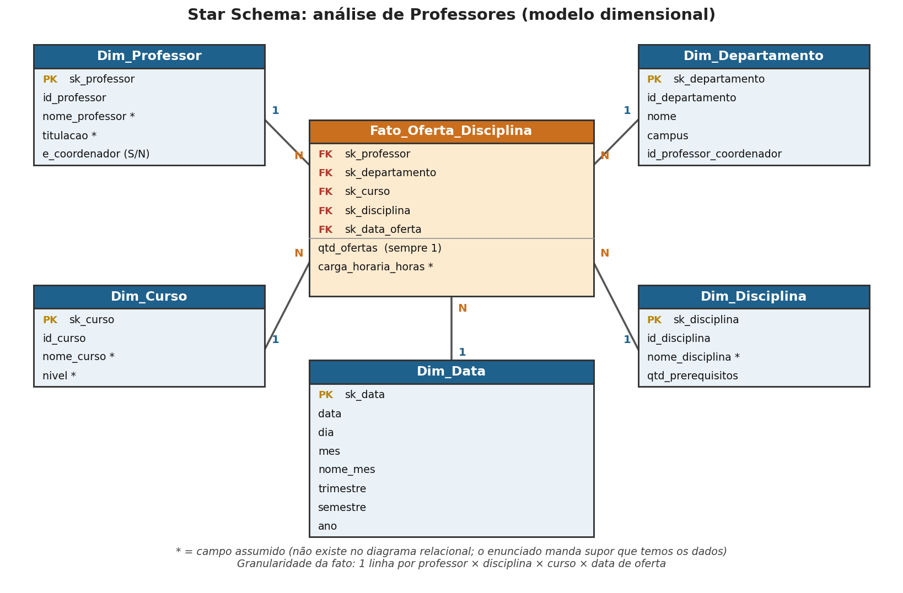

# Desafio DIO: Star Schema para análise de Professores

Projeto de modelagem dimensional (esquema em estrela) criado a partir do diagrama relacional de uma universidade, com foco na **análise dos professores**.

## 🎯 Objetivo

Criar o diagrama dimensional (star schema) com uma **tabela fato**, as **tabelas dimensão** e uma **dimensão de datas**. Dados de alunos não precisam aparecer no modelo.

## 🗺️ Diagrama

## 🧱 Tabelas do modelo

| Tabela | Tipo | Origem no modelo relacional |
|---|---|---|
| `Fato_Oferta_Disciplina` | Fato | `Disciplina` e `Disciplina & Curso` |
| `Dim_Professor` | Dimensão | `Professor` |
| `Dim_Departamento` | Dimensão | `Departamento` |
| `Dim_Curso` | Dimensão | `Curso` |
| `Dim_Disciplina` | Dimensão | `Disciplina` e `Pré-requisitos das disciplinas` |
| `Dim_Data` | Dimensão | Criada para o modelo (data de oferta) |

## 📏 Granularidade da fato

Cada linha da fato representa **uma disciplina ministrada por um professor, em um curso, em uma data de oferta**.

**Medidas:**
- `qtd_ofertas`: sempre 1, usada para contar ofertas
- `carga_horaria_horas`: carga horária da oferta

## 🧠 Decisões de modelagem

- **Alunos fora do modelo:** `Aluno` e `Matriculado` não entram, conforme o enunciado.
- **Relação muitos-para-muitos resolvida na fato:** `Disciplina & Curso` ligava disciplinas a cursos. No modelo dimensional, cada linha da fato já traz o curso.
- **Pré-requisitos como atributo:** em vez de uma tabela ligada a outra dimensão (o que faria o desenho deixar de ser uma estrela), guardei a quantidade em `Dim_Disciplina.qtd_prerequisitos`.
- **Chaves substitutas (`sk_`):** o modelo dimensional tem chaves próprias, e o id do banco relacional fica como atributo (`id_...`).
- **Dimensão de datas:** o modelo relacional não tinha datas. Supus que temos a data de oferta das disciplinas e criei `Dim_Data` com dia, mês, nome do mês, trimestre, semestre e ano, para permitir análises em vários níveis de granularidade.

## ❓ Campos assumidos

O enunciado manda supor que temos acesso aos dados. Estes campos **não existem no diagrama relacional** e foram supostos (marcados com `*` no diagrama):

- `Dim_Professor`: `nome_professor`, `titulacao`
- `Dim_Curso`: `nome_curso`, `nivel`
- `Dim_Disciplina`: `nome_disciplina`
- Fato: `carga_horaria_horas`
- `Dim_Data`: todos os campos

## 📁 Conteúdo do repositório

- `star-schema-professor.png`: diagrama do modelo dimensional
- `star_schema.sql`: script MySQL que cria as tabelas
- `README.md`: este arquivo

## 🧠 O que aprendi

Aprendi a diferença entre fato e dimensão, o que é granularidade, e por que uma dimensão de datas ajuda nas análises.

## 🔗 Referências

- Diagrama relacional fornecido no enunciado do desafio da DIO
